# Vaanika website in 3D: storyboard

Branch `site-3d` (from `claude/new-session-ox4tcm`). Preview only; it goes live only when the owner says "put it live".

**The idea.** Scrolling is the flight: the night palace, wheels up, across India, the helicopter landing before the palace, the lotus opening. One midnight sky (stars and gold dust) sits behind every page, and each chapter has one 3D moment that the scroll drives. Quiet luxury: slow, eased, never bouncy; gold light on midnight blue.

## How it is built

| Piece | Where | What it does |
|---|---|---|
| Motion switch | inline script in `layouts/Base.astro` | Before first paint: adds `motion` to `<html>` unless the visitor asked for reduced motion or Save-Data. Pinned and horizontal layouts exist only under `.motion`. |
| Motion module | `src/motion/` | Easing and duration tokens, device tier (`tier.ts`, unit-tested), one scroll loop that turns each chapter's storyboard (data: start, end, what moves) into progress values. |
| 3D module | `src/three/` | One WebGL renderer per page on one fixed canvas behind the content: the sky first, then each visible stage drawn into its own rectangle (scissor). Renders only while something changes, pauses when the tab is hidden, caps the pixel ratio (1.5 phones, 2 desktop). |
| Models | `src/assets/3d/*.glb` | The film's own jet, helicopter, palace and logo petals, exported by `video/scripts/export-gltf.mjs` on the `video-film` branch (quantised glTF, no decoder). |
| Map | `src/three/data/coast.json` | India's coastline only, from Natural Earth (public domain), made by `apps/site/scripts/coastline.py`. No land border is drawn: the map fades into the night to the north. |
| Stills | `src/assets/3d/stills/` | A rendered still of every 3D moment. Shown under reduced motion, without WebGL, on low-end devices, and as the placeholder until the 3D is ready. |

**Device tiers.** High: full 3D. Mid: the same scenes with simpler materials, fewer particles and a lower pixel ratio. Low (no WebGL, software rendering, very little memory, or a frame-time check that fails): stills and CSS reveals only. Reduced motion: stills, no scroll-driven motion, no parallax, no autoplay. No JavaScript: the normal page with stills.

**Never an empty frame.** Every 3D moment shows a tiny blurred placeholder (written into the page) and then its still; the 3D replaces the still only after its first frame has been checked to contain something. If the 3D is not ready 1.5 s after the moment comes into view, or WebGL fails or runs slow, the still stays. `?debug=3d` shows the device's tier and what each moment is doing.

**Nothing moves by itself for more than 5 seconds.** All 3D motion follows the scroll and settles within about a second after the visitor stops. The two things that do move on their own (the hero film and the trust strip) each have a pause control.

## Home page

Positions are the share of each chapter's scroll range: 0% is when the chapter starts to drive (usually its top reaching the top of the window), 100% when it hands over to the next.

### 1. Hero: the night palace

| Scroll | What the visitor sees |
|---|---|
| 0% | The background film (lake palace, jet, helicopter) at full brightness; eyebrow, headline, line and button settled. |
| 25% | The film has grown 3% and dimmed slightly; the eyebrow lifts away. |
| 50% | Headline lines lift away one after another (by line, never by letter); the sub-line has gone. |
| 75% | The film is down to a third of its brightness; stars of the sky world show through. |
| 100% | The film has faded into the midnight sky; no hard edge before the trust strip. |

### 2. Trust strip

| Scroll | What the visitor sees |
|---|---|
| Always | The slow marquee. A soft gold glint sits at the centre; each promise brightens as it passes through it. Pauses on hover, focus or tap. Static wrap under reduced motion. |

### 3. The Vaanika Standard: the four checks and the four parts of the mark

Each card has its part of the lotus: 01 Operator permit → Saraswati (ivory), 02 The aircraft → Lakshmi (gold), 03 Insurance → Kali (shyama blue), 04 Landing permissions → the chandra.

| Scroll | What the visitor sees |
|---|---|
| Arriving | The heading, then the whole lotus (a still from the first moment; the 3D takes over only after its first frame has been checked), then the cards. Nothing is pinned on phones. |
| Card 01 in the middle | Its border glows softly, and so does the ivory Saraswati petal. |
| Card 02 | The gold Lakshmi petal. |
| Card 03 | The blue Kali petal. |
| Card 04 | The chandra. |

Wider screens: heading and lotus on the left (sticky); on the right, a short gold label "Four checks, every quote" level with the heading's top, then the cards, starting beside the lotus so the whole lotus is in view while card 01 is in the middle. (Phones keep the label for screen readers only.) Under reduced motion nothing glows. The section is at most about 1.3 screens tall on desktop and 2 on phones.

### 4. Three moments: a pinned horizontal journey

| Scroll | What the visitor sees |
|---|---|
| 0% | The section pins. Panel I, "Wheels up, together", fills the view; its photo sits deep behind the frame. |
| 0–33% | The track slides left. Photos move slower than their frames, the text a little faster (2.5D depth); gold dust drifts in front. |
| 50% | Panel II, "Only your people", centred. |
| 100% | Panel III, "The entrance", centred; the section unpins and the page carries on. |

Vertical reading still works: the panels are in document order; keyboard and screen readers read them top to bottom.

### 5. Destinations: across India

| Scroll | What the visitor sees |
|---|---|
| 0% | The map pins: a dark, faceted India seen from the south-west, its coastline drawn in gold, the north fading into night. Delhi, Mumbai, Bengaluru and Kolkata glow. |
| 10–30% | Gold contrails draw Delhi → Udaipur and Mumbai → Udaipur; Udaipur rises with its flying times. |
| 35–55% | Delhi → Jaipur and Kolkata → Jaipur; Jaipur rises. |
| 60–80% | Bengaluru → Goa and Delhi → Goa; Goa rises. |
| 100% | All six routes lit; the destination pins stay tappable (hover or tap raises the card); the section unpins into the photo cards. |

Only the flying times already on the site are shown, with their "verify" marks on preview builds.

### 6. Choose your arrival: the showroom

| Scroll | What the visitor sees |
|---|---|
| 0% | The section pins. A studio floor with a gold ring; the helicopter turns slowly with the scroll; its card (photo, name, guests) on the side. |
| 20% | Light jet: the helicopter sinks away, the jet rises in its place; the guest count counts to its existing value. |
| 40% | Super-midsize: the same jet, larger. |
| 60% | Heavy jet: larger again; the camera eases back. |
| 80% | Group charter: the airliner; the camera at its widest. |
| 100% | The section unpins. |

Relative size is shown by scale only; no lengths or other new numbers appear.

### 7. The Shreeji Arrival

| Scroll | What the visitor sees |
|---|---|
| 0% | The section pins. Night; the lit palace across the lawn; a ring of diyas marks the landing spot. Text on the left, on its own shade. |
| 0–70% | The helicopter comes in from the upper right and descends, rotor turning with the scroll. |
| 70–85% | Near the ground: downwash ripples across the lawn; a few marigold petals lift and swirl, always away from the text. |
| 85% | Touchdown; the rotor winds down and stops. |
| 100% | The section unpins. |

### 8. How it works and the sample quote (ivory)

| Scroll | What the visitor sees |
|---|---|
| Entering | A gold flight path draws down through the four steps as you read them. |
| Quote card | The card's lines assemble one after another (route, aircraft, operator, permit, insurance, all-in price); "Checked" ticks in last. No count-ups: the card has no counted numbers. |

### 9. Beyond weddings and For planners

Subtle depth: the photo moves slower than the text; magnetic primary buttons on desktop. Nothing pinned.

### 10. The name story: the lotus opens

| Scroll | What the visitor sees |
|---|---|
| 0% | The section pins. The petals are closed together, dim, at the centre. |
| 20% | The Saraswati petal opens to the left; "Saraswati" appears beside it. |
| 40% | The Lakshmi petal rises in the centre; "Lakshmi". |
| 60% | The Kali petal opens to the right; "Kali". |
| 75% | The crescent appears above; "the chandra". |
| 90% | The base line draws; the heading and lead fade in below. |
| 100% | The section unpins. |

### 11. FAQ, enquiry form, footer

Calm and still. The sky stops moving before the FAQ; nothing moves near form fields.

## Other pages

All pages share the sky, cross-document View Transitions (header and gold hairline stay put; the content cross-fades) and scroll reveals.

| Page | Signature moment |
|---|---|
| Helicopter arrivals | The helicopter in the page header, turning with the scroll; the landing-permission steps joined by a gold path that draws as you read. |
| Aircraft | The showroom turntable, stepping through the five classes. |
| Each destination | Its own flight arcs: the four cities to that destination, with that page's flying times. |
| About | The lotus opening. |

## Key-moment stills

Rendered from the live 3D scenes (`apps/site/scripts/render-stills.cjs`); the same images are the
fallbacks under reduced motion, without WebGL and on low-end devices.

| Chapter | Key moment |
|---|---|
| The Vaanika Standard: the lotus (transparent still) |  |
| Destinations: all six routes drawn | 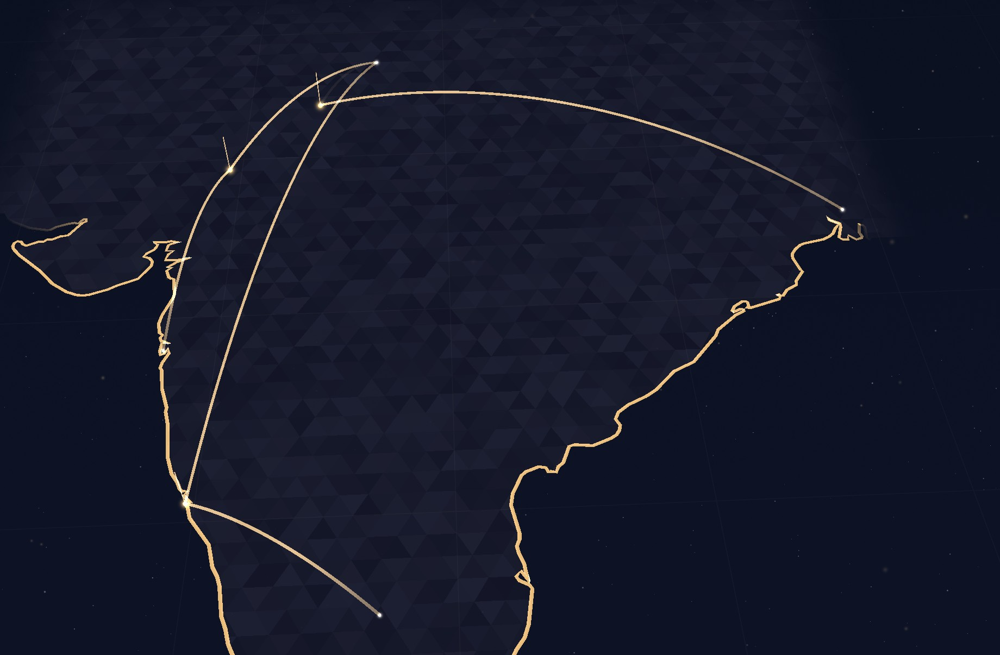 |
| Showroom: helicopter | 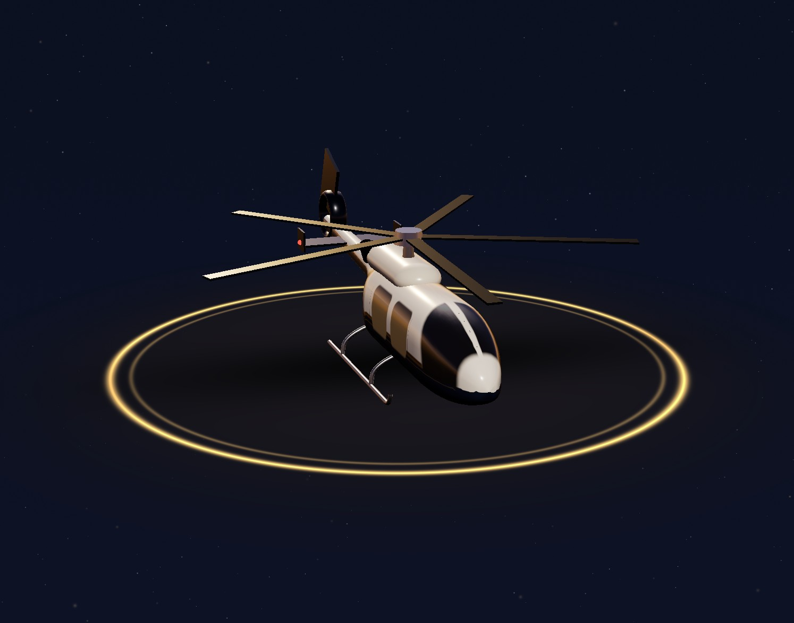 |
| Showroom: light jet | 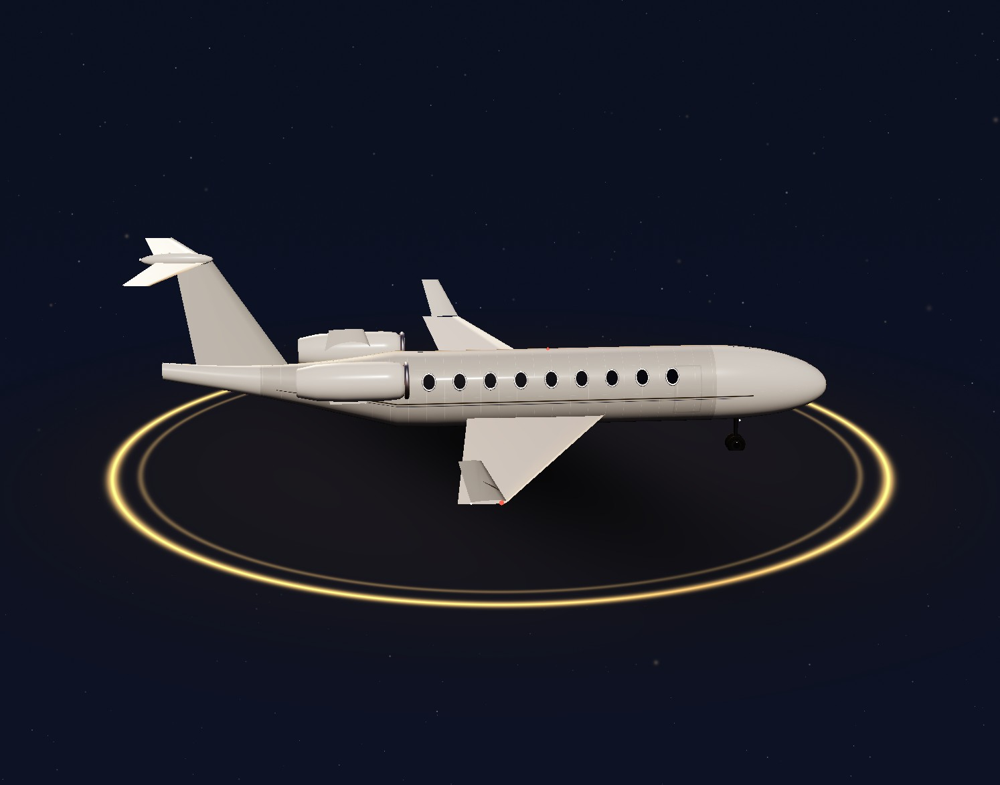 |
| Showroom: super-midsize | 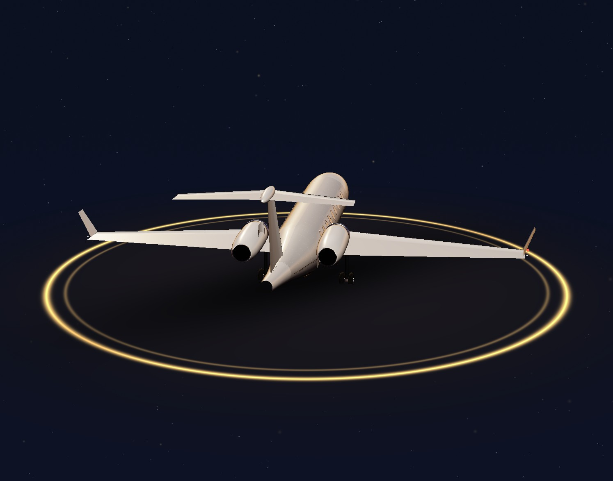 |
| Showroom: heavy jet | 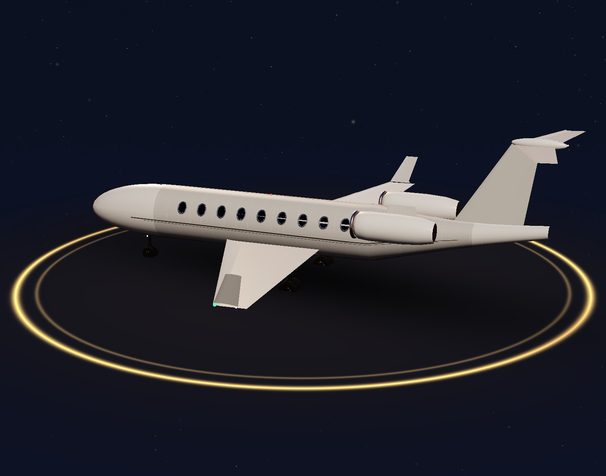 |
| Showroom: group charter | 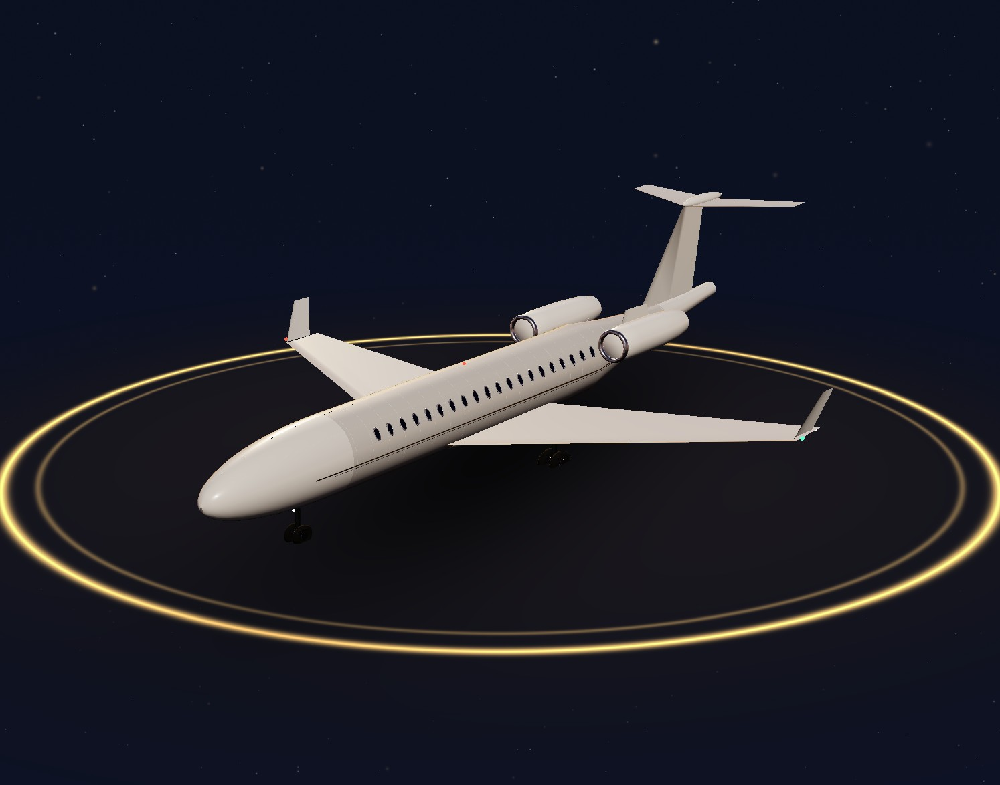 |
| The Shreeji Arrival: touchdown | 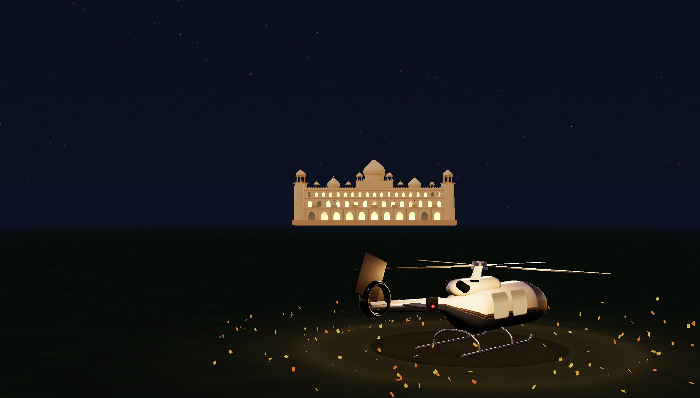 |
| The name story: the lotus open |  |
| Helicopter arrivals | 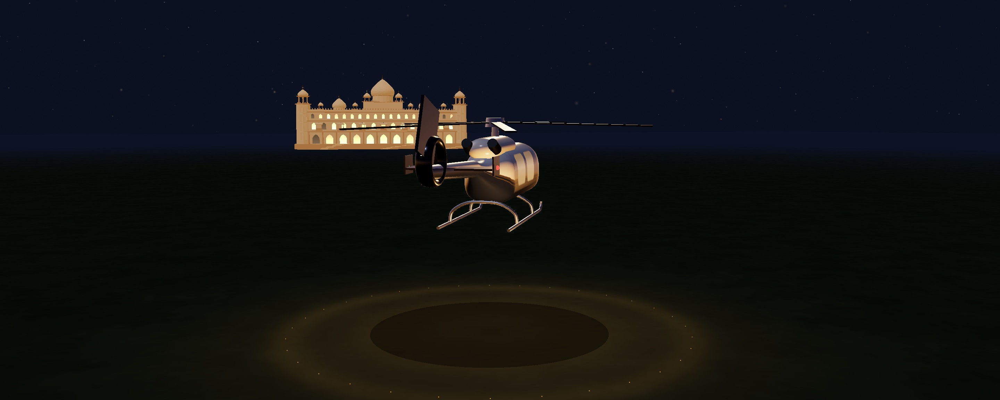 |
| Udaipur page: its four routes | 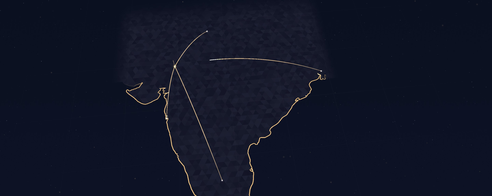 |
| Jaipur page | 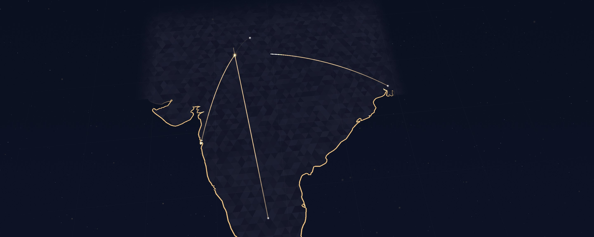 |
| Goa page | 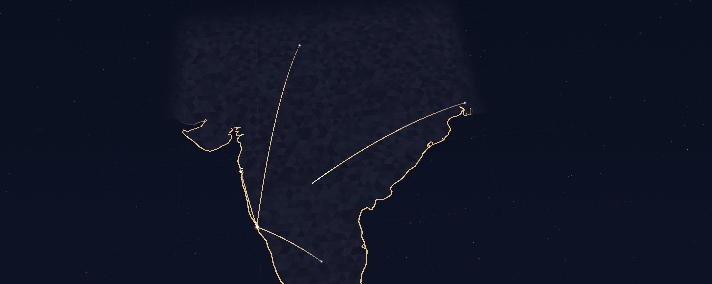 |
